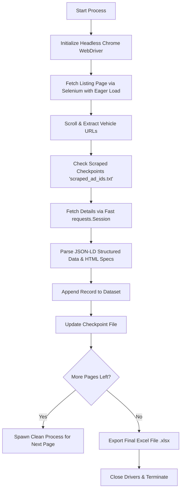

# 🚗 ContactCars Used Cars Web Scraper

An automated, high-performance web scraper designed to extract used car listings and comprehensive technical specifications from [ContactCars.com](https://www.contactcars.com/en/cars) (Egypt's automotive marketplace). 

The scraper employs a **Hybrid Architecture** combining Selenium WebDriver with lightweight HTTP requests and JSON-LD parsing to achieve maximum speed, stability, and data completeness.

---

## 📌 Project Overview

ContactCars hosts tens of thousands of active vehicle listings with rich metadata (prices, mechanical specifications, seller remarks, and timestamps). However, because listing pages rely on client-side JavaScript rendering and dynamic element loading, standard static scrapers fail to extract search results reliably.

This project delivers:
- **Resilient extraction** of car listings across multiple search pages.
- **Rich spec extraction** combining structured Schema.org JSON-LD and HTML parsing fallbacks.
- **Data output** formatted into an Excel spreadsheet (`contactcars_used_cars.xlsx`).
- **Fault-tolerant execution** with automatic checkpoints and process recycling.

---

## ⚙️ Architecture & Pipeline



### 1. Hybrid Fetching Strategy
- **Listing & Discovery (Selenium Chrome)**: Headless Chrome navigates the search results, executes JavaScript, overcomes dynamic rendering, and extracts validated car detail URLs.
- **Detail Extraction (HTTP Requests Session)**: Rather than keeping a heavy browser open for every single car page, detail URLs are fetched using high-speed `requests.Session` with customized browser headers. This accelerates scraping by over **5x–10x**.

### 2. Dual-Layer Parsing
- **Primary Source (JSON-LD Schema)**: Parses embedded `<script type="application/ld+json">` (`@type: Vehicle`) containing standardized properties (Make, Model, Production Year, Trim, Price, Currency, Transmission, Fuel Type, and Odometer).
- **Secondary Source (BeautifulSoup DOM)**: Traverses DOM elements to scrape seller notes, localized pricing details, relative publication dates, and specific multi-attribute specification tables.

---

## 🛡️ Challenges Encountered & Engineering Solutions

| # | Challenge Faced | Root Cause | Solution Implemented |
|---|---|---|---|
| **1** | **Infinite Page Hangs & Timeouts** | ContactCars pages load heavy third-party tracking scripts, ads, and media that cause standard Selenium `driver.get()` calls to hang indefinitely. | Configured `options.page_load_strategy = 'eager'` (proceeds as soon as the DOM is interactive without waiting for stylesheets/images) and wrapped navigation in `safe_navigate()` to issue `window.stop()` if a timeout is reached. |
| **2** | **Bot Detection & WebDriver Flags** | Modern anti-bot protections detect default automation parameters in Chromium. | Added anti-detection Chrome flags (`--disable-blink-features=AutomationControlled`, excluded automation switches) and injected CDP scripts resetting `navigator.webdriver`, `languages`, and `plugins`. |
| **3** | **Memory Leaks & Browser Bloat in Long Runs** | Running a single continuous Chrome WebDriver session across hundreds of pages causes memory bloat, socket exhaustion, and sporadic driver crashes. | Implemented self-terminating process recycling (`_relaunch_for_next_page`). Each page is processed in an isolated run, passing configuration forward without memory leaks. |
| **4** | **Interrupted Runs & Duplicate Work** | Network drops or script interruptions could force scraping to restart from scratch. | Integrated persistent checkpointing (`scraped_ad_ids.txt`). Each processed ad ID is recorded, allowing instant resumption without duplicate entries. |
| **5** | **Irregular Data Formatting** | Sellers often omit fields or format units differently (e.g., mileage with `KM`, engine capacity with `CC`, or mixed Arabic/English text). | Built dedicated extraction helpers and regex cleaners that standardize numerical attributes, currencies, and descriptions into uniform columns. |

---

## 📊 Extracted Data Schema

The scraper extracts 18 attributes per vehicle, exported to `contactcars_used_cars.xlsx`:

| Field Name | Description | Example |
|---|---|---|
| `Ad ID` | Unique listing identifier | `1234567` |
| `Ad URL` | Full link to the vehicle page | `https://www.contactcars.com/en/used-cars/...` |
| `Brand` | Vehicle manufacturer | `Toyota` |
| `Model` | Vehicle model | `Corolla` |
| `Year` | Year of manufacture | `2021` |
| `Trim` | Vehicle trim / specification | `Comfortline` |
| `Price (EGP)` | Listed price in Egyptian Pounds | `850000` |
| `Currency` | Currency denomination | `EGP` |
| `Listed Date (ISO)` | ISO publication date | `2024-05-12T14:20:00Z` |
| `Listed Date (Relative)` | Friendly relative time | `2 days ago` |
| `Car Status` | New / Used condition | `Used` |
| `Body Shape` | Sedan, SUV, Hatchback, etc. | `Sedan` |
| `Transmission` | Automatic / Manual | `Automatic` |
| `Mileage` | Odometer reading | `45,000 KM` |
| `Fuel Type` | Petrol, Diesel, Hybrid, Electric | `Petrol` |
| `Engine Capacity` | Engine displacement | `1600 CC` |
| `Color` | Exterior body color | `Black` |
| `Cylinder Count` | Number of cylinders | `4` |
| `Description` | Full seller remarks and notes | _"First owner, factory condition..."_ |

---

## 🚀 Getting Started

### Prerequisites
- **Python 3.8+**
- **Google Chrome** installed on your system.

### Installation

1. **Clone the repository:**
   ```bash
   git clone https://github.com/moatasimyakoub92-dot/Cars_Scrabing.git
   cd Cars_Scrabing
   ```

2. **Create and activate a virtual environment (optional but recommended):**
   ```bash
   python -m venv venv
   # On Windows:
   venv\Scripts\activate
   # On macOS/Linux:
   source venv/bin/activate
   ```

3. **Install dependencies:**
   ```bash
   pip install -r requirements.txt
   ```

---

## 💻 Configuration & Usage

Open `Used_cars.py` to customize the scraping parameters:

```python
# ================= Configuration =================
START_PAGE = 1       # Page number to start scraping from
MAX_PAGES = 5        # Total number of search pages to scrape
HEADLESS = True      # True to run Chrome invisibly in background
DETAIL_DELAY = 0.5   # Polite delay between detail page requests (seconds)
```

Run the scraper:
```bash
python Used_cars.py
```

- Progress and errors are logged both to the terminal and saved in `scraper.log`.
- All processed ad IDs are stored in `scraped_ad_ids.txt`.
- When complete, the data will be compiled into `contactcars_used_cars.xlsx`.

---

## 📂 Project Structure

```plaintext
Cars_Scrabing/
├── .gitignore                      # Excludes cache, logs, and raw CSV files
├── requirements.txt                # Python dependencies
├── Used_cars.py                    # Main scraper script (Selenium + Requests + BS4)
├── contactcars_used_cars.xlsx       # Output dataset in Excel format
├── scraped_ad_ids.txt              # Checkpoint log tracking processed IDs
└── README.md                       # Documentation, architecture, and guides
```

---

## 🌐 نبذة عن المشروع باللغة العربية (لوصف المشروع على منصات العمل الحر / مستقل / خمسات)

### 📌 عنوان المشروع:
**سحب واستخراج بيانات سوق السيارات المستعملة في مصر من موقع ContactCars (Web Scraping & Data Engineering)**

### 📝 نبذة تعريفية:
مشروع احترافي متكامل لجمع واستخراج آلاف إعلانات السيارات المستعملة المعروضة للبيع على منصة **ContactCars** (أكبر منصة لتجارة السيارات في مصر)، وتنظيمها في قاعدة بيانات إكسل مهيأة للدراسة وتحليل السوق والتسعير الذكي.

تم بناء الأداة باستخدام لغة **بايثون (Python)** وفق معمارية هجينة متطورة توازن بين القدرة على التعامل مع الصفحات الديناميكية المعقدة والسرعة الفائقة في جمع التفاصيل.

---

### ⚙️ الميزات التقنية والمعمارية البرمجية:
1. **معمارية هجينة فائقة السرعة (Hybrid Architecture)**:
   - دمج محرك **Selenium (Headless Chrome)** للتعامل مع صفحات البحث وقوائم الإعلانات التي تعتمد على الجافاسكريبت (Dynamic JS Rendering).
   - استخدام **Requests Session** مهيأة بترويسات متصفح حقيقي لسحب صفحات التفاصيل بسرعة مضاعفة (تفوق 10 أضعاف الحلول التقليدية).
2. **استخراج ذكي للبيانات (Structured JSON-LD & DOM Parsing)**:
   - الاعتماد المباشر على بيانات Schema المنظمة للمركبات (`@type: Vehicle`) لضمان أقصى درجات الدقة.
   - استخدام خوارزميات بديلة عبر **BeautifulSoup** لمعالجة الملاحظات، تواريخ النشر النسبية، وتفاصيل المواصفات المكتوبة باللغة العربية والإنجليزية.
3. **التغلب على الحظر وحماية الموقع (Anti-Detection & Stealth)**:
   - تخطي تقنيات رصد برمجيات الأتمتة (Bypass Bot Detection) عبر ترويسات متقدمة وإخفاء هوية الـ WebDriver عبر بروتوكول CDP.
4. **نظام استئناف ذكي ونقاط فحص (Fault Tolerance & Checkpointing)**:
   - حفظ كل إعلان فور استخراجه في ملف تدقيق (`scraped_ad_ids.txt`) لمنع تكرار سحب أي إعلان عند إعادة تشغيل البرنامج أو حدوث انقطاع في الاتصال.
5. **معالجة مشاكل الذاكرة والصفحات العالقة**:
   - ضبط استراتيجية تحميل الصفحة على `eager` لعدم انتظار الإعلانات والصور الثقيلة.
   - نظام إعادة تدوير العملية البرمجية تلقائياً لمنع أي تسريب للذاكرة (Memory Leak) أثناء عمليات السحب الضخمة.

---

### 📊 الحقول والبيانات المستخرجة (18 حقلاً تفصيلياً):
- **معلومات أساسية**: رقم الإعلان (Ad ID)، رابط الإعلان المباشر (Ad URL)، تاريخ النشر.
- **مواصفات المركبة**: الماركة (Brand)، الموديل (Model)، سنة الصنع (Year)، الفئة (Trim).
- **التسعير**: السعر المعروض، العملة (EGP).
- **الحالة الفنية والميكانيكية**: حالة السيارة، شكل الهيكل (Body Shape)، نوع ناقل الحركة (Transmission)، قراءة العداد (Mileage)، نوع الوقود (Fuel Type)، السعة اللترية للمحرك (CC)، عدد الأسطوانات، واللون الخارجي.
- **الملاحظات**: الوصف الكامل المكتوب من البائع دون اختصار.

---

### 🛠️ الأدوات والتقنيات المستخدمة:
- **لغات وتقنيات**: Python 3, Selenium WebDriver, BeautifulSoup4, Requests, Regular Expressions (Regex).
- **هندسة ومعالجة البيانات**: Pandas, OpenPyXL.
- **إدارة الإصدارات**: Git & GitHub.

---

## ⚖️ License & Disclaimer

This project was built for educational and research purposes. Please observe ContactCars' Terms of Service, respect website server load via request throttling, and adhere to local web scraping regulations.
